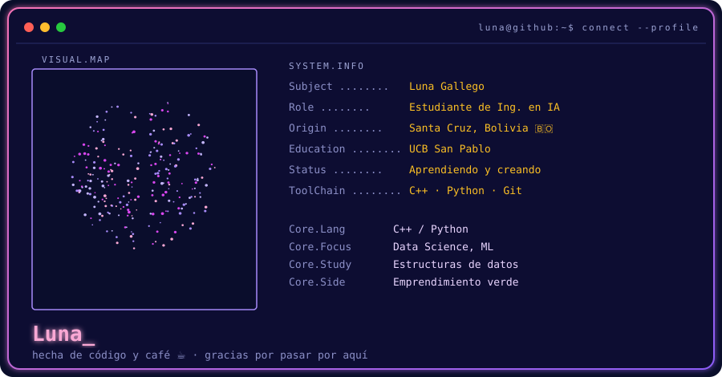
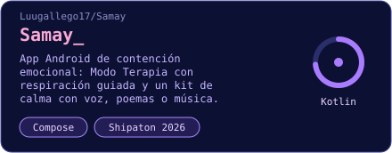
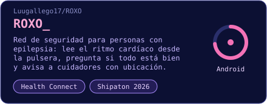
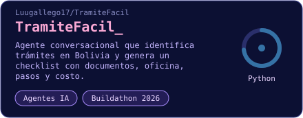
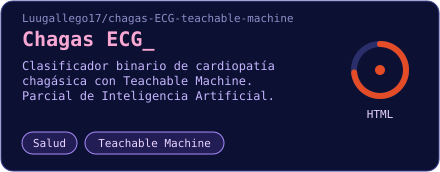
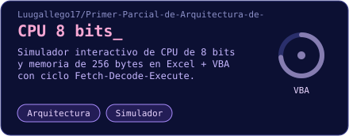
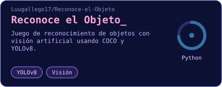

  

  
  
  
  

### `> about.sh`

- 🎓 Estudiando **Ingeniería en Inteligencia Artificial** en la UCB "San Pablo" 🇧🇴
- 🌷 Me apasiona la **ciencia de datos, la optimización y el aprendizaje automático**
- 🌱 Ahora profundizando en estructuras de datos y metodología de investigación
- 💡 Exploro proyectos de emprendimiento con enfoque en tecnología y sostenibilidad

### `> stack.list`

  
  
  
  

### `> projects.list --featured`

<table align="center">
<tr>
<td></td>
<td></td>
</tr>
<tr>
<td></td>
<td></td>
</tr>
<tr>
<td></td>
<td></td>
</tr>
</table>

### `> stats --github`

  
  

  

### `> contributions.map`

  

### `> connect --all`

  
  

